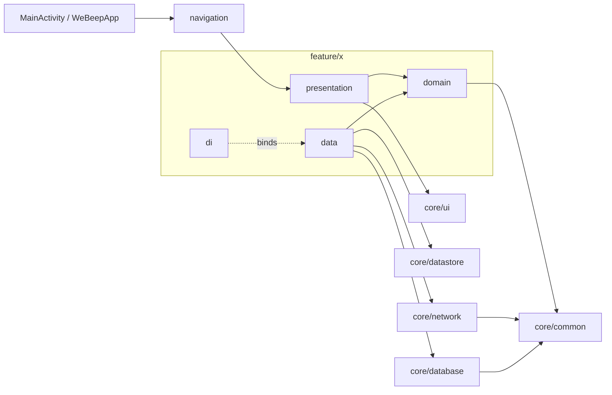

# Architecture

WeBeep Android is a single Gradle module (`:app`). Sources live in `app/src/main/java/it/polimi/webeep`. The app reads Moodle's REST web service, keeps the result in Room, and draws it with Jetpack Compose. Reads go through the local cache first, so screens work offline.

Decisions behind this layout are in [docs/adr](adr/README.md). Contribution rules are in [CONTRIBUTING.md](../CONTRIBUTING.md).

## Package map

All paths are relative to `app/src/main/java/it/polimi/webeep`.

| Package | Contents |
|---|---|
| `core/common` | `Resource`, `DataError`, `resourceOf`, `runCatchingCancellable`, `cacheThenRefresh`, `ConnectivityObserver`, `stripAuthFromUrl` (`MoodleUrls.kt`), Moodle text and exception helpers. Pure Kotlin. |
| `core/network` | `MoodleApiService` (Ktor over OkHttp), the interceptors, DTOs in `dto/`, `LogRedactor`, `NetworkMonitor`, `MoodleFileUrlBuilder`, `MoodleBinaryDownload`. |
| `core/database` | `WeBeepDatabase` (Room), `DatabaseMigrations`, `dao/`, `entity/`. |
| `core/datastore` | `TokenProvider` / `TokenManager`, `SecureStore` (Tink), `LegacyEncryptedPrefsMigration`. |
| `core/session` | `SessionExpiryHandler`, the `SessionDataCleaner` interface; `data/SessionDataCleanerImpl`. |
| `core/storage` | `LocalFileStore` (size-capped private directory), `MimeTypes.kt`. |
| `core/ui` | `components/` (shared composables), `theme/`, `util/` (`ObserveEffects`, `DataErrorMessages.kt`, motion and window helpers). |
| `core/di` | Hilt modules for dispatchers, network, database, DataStore and core bindings. |
| `feature/auth` | SSO login. |
| `feature/dashboard` | Course list, search and filters, profile header. |
| `feature/course` | Course sections, modules and files; `CourseContentMapper`. |
| `feature/download` | Downloads to private storage, `DownloadTracker`. |
| `feature/fileviewer` | PDF, media, image and code viewers. |
| `feature/settings` | Theme, language, sync frequency, Wi-Fi only, logout. |
| `feature/sync` | `CourseSyncWorker`, scheduling, change detection, notifications, `SyncState`. |
| `navigation` | `Routes.kt`, `NavGraph.kt`, `NavTransitions.kt`, `NavigationCallbacks.kt`. |

Each `feature/<x>` is split into `domain`, `data`, `presentation` and `di`. `feature/sync` also keeps `CourseSyncWorker` at its root (see [Background sync](#background-sync)). `feature/download` and `feature/sync` have no `presentation` package.

## Dependency rule



- `presentation` and `data` depend on `domain`. `domain` depends on neither. No `domain` file imports `android.*` or `androidx.*`.
- `presentation` never imports another feature's `data`. `domain` never imports `core/ui`.
- `data` talks to `core/network`, `core/database` and `core/datastore`. Repository interfaces live in `domain`; implementations are bound in `feature/<x>/di`.
- Features may use another feature's `domain` types. Current links: `course` to `download`; `fileviewer` to `course` and `download`; `auth` and `settings` to `sync`; `settings` to `auth`; `sync` to `course`, `dashboard` and `settings`.
- `core/session` is the exception that points the other way: `SessionExpiryHandler` uses `AuthRepository`, and `SessionDataCleanerImpl` uses the download and sync repositories, because logout must wipe all of them.
- `navigation` is the only place that knows every feature's destination.

## Data flow

Example: the course contents screen.

```
Moodle REST (webservice/rest/server.php)
  -> MoodleApiServiceImpl        POST form, Ktor over the OkHttp client
  -> interceptors                Retry, PluginFileAuth, Token, Logging; NoStoreAuthCache (network level)
  -> CourseSectionDto            core/network/dto
  -> CourseContentMapper.map     feature/course/data; filters modules, strips tokens from URLs
  -> Course*Entity               Room, written by CourseContentDao.replaceCourseContent
  -> toDomain() (CourseEntityMapper.kt)   Room entities to Section / Module / FileResource
  -> GetCourseContentsUseCase    cacheThenRefresh
  -> CourseDetailViewModel       combines the flow with search and folder state
  -> CourseDetailUiState         rendered by CourseDetailScreen
```

Details:

- `MoodleApiService` has three calls: `getSiteInfo`, `getEnrolledCourses`, `getCourseContents`. Requests are `POST` forms. `TokenInterceptor` adds `wstoken` to the form body for the trusted host (`MoodleFileUrlBuilder.TRUSTED_HOST`). It also clears the session on 401, or on a 403/200 body that carries `invalidtoken` or `accessexception`.
- `RetryInterceptor` retries only idempotent methods and POSTs marked read-only by `MoodleApiServiceImpl.READ_ONLY_WS_HEADER`, up to 3 attempts with backoff.
- `PluginFileAuthInterceptor` appends `token=` to `pluginfile.php` file requests, because Moodle requires it there. `NoStoreAuthCacheInterceptor` marks such responses `no-store` so they never reach the OkHttp disk cache.
- Moodle errors in a 200 response become `MoodleException`. `toDataError()` (`core/common/DataErrorMapper.kt`) classifies them.
- The dashboard follows the same shape: `DashboardRepositoryImpl.syncCourses` maps `CourseDto` to `CourseEntity` and calls `CourseDao.replaceAllCourses`. `GetCoursesUseCase` wraps it in `cacheThenRefresh`.
- Mappers are the single place where URLs are stripped (`stripAuthFromUrl`) before they reach Room.
- Repositories switch to the injected `@DefaultDispatcher` for mapping. Dispatchers come from `core/di/DispatcherModule.kt`; do not hard-code `Dispatchers.*` in new code.

## Offline-first

`cacheThenRefresh` (`core/common/CacheThenRefresh.kt`) is shared by `GetCoursesUseCase` and `GetCourseContentsUseCase`.

1. It collects the Room flow and emits every cache change as `Resource.Success`.
2. If `ConnectivityObserver.isOnline` is true, it runs the refresh. If the check itself fails, it assumes online.
3. While the refresh runs, an empty cache emits nothing, so the UI does not flash an empty state.
4. A refresh error is emitted only when the cache is empty. With cached data, the error is dropped and the user keeps the cached list.
5. After the refresh, an empty cache is reported as an empty list. `emitEmptyAfterError` controls whether that also follows an error (the course detail needs a final "loaded" state; the dashboard does not).

Offline, the refresh is skipped. The cache is shown as is. `SyncCoursesUseCase` (pull-to-refresh) is the opposite: it fails fast with `DataError.Network` when offline. Downloaded files and the viewer cache are plain files in app-private storage, so they open without a network.

Room is the source of truth. Its schema version is 4 (`WeBeepDatabase`). Migrations are in `DatabaseMigrations.ALL`. Release builds fall back to a destructive reset only on downgrade; debug builds also reset on a missing migration (`core/di/DatabaseModule.kt`).

## Error model

- `Resource<T>` is `Success(data)` or `Error(error: DataError, throwable)`.
- `DataError` is `Network`, `Unauthorized`, `Server(errorCode)`, `Storage` or `Unknown`.
- Data-layer calls return `Resource` through `resourceOf { ... }`. It maps any `Exception` with `toDataError()` and keeps the throwable for logging.
- The UI never shows exception text. `DataError.toMessageRes()` (`core/ui/util/DataErrorMessages.kt`) maps each case to a string resource. The file viewer has its own finer mapping, `DataError.toViewerError()` in `feature/fileviewer/presentation/FileContentState.kt`. Login uses `LoginError` and `LoginErrorMapper`.
- **Cancellation rule.** `resourceOf` rethrows `CancellationException`. Best-effort code that does not return a `Resource` uses `runCatchingCancellable`, which also rethrows it. Never use `runCatching` around suspending code, and never catch `Exception` without rethrowing cancellation.
- `Resource<T>.getOrThrow()` is for code, like the sync worker, that wants to turn a failure back into an exception it handles itself.

## UI conventions

Every screen follows the same pattern. `feature/course/presentation` is the fullest example.

- **UiState.** One `StateFlow<XUiState>` per ViewModel. State is immutable (`@Immutable` data classes, sealed interfaces for mutually exclusive stages such as `DashboardContent`). Strings in state are `@StringRes` ids, not text.
- **Action.** `XAction` is a sealed interface of user intents. The ViewModel exposes `onAction(action)`. Screens that need only one or two callbacks may pass lambdas instead (`DashboardScreen` takes navigation lambdas next to `onAction`).
- **Effect.** One-shot events that need an Activity or navigation use `Channel<XEffect>(Channel.BUFFERED)` exposed as a flow. Features with effects: auth, course, fileviewer, settings. The dashboard has none.
- **Route / Screen split.**
  - `XRoute` owns the `hiltViewModel()`, collects state with `collectAsStateWithLifecycle`, and handles effects with `ObserveEffects` (`core/ui/util/ObserveEffects.kt`, which collects only while the screen is STARTED).
  - `XScreen(state, onAction, ...)` is stateless. It gets everything as parameters, which is what makes Compose UI tests and previews cheap.
- **Previews.** Stateless screens and components have `@Preview` functions. Shared sample data sits beside them (`CourseDetailPreviewData.kt`, `CourseCardPreviews.kt`). Kover excludes `@Preview` functions.
- Navigation callbacks are wrapped with `dropUnlessResumed` so a tap during a transition does not push twice.

## Navigation

- Routes are `@Serializable` types in `navigation/Routes.kt`: `Login`, `Dashboard`, `Settings`, `CourseDetail(courseId)`, `FileViewer(url, title, mimeType, courseId)`.
- Routes carry only what a screen cannot look up itself. They never carry tokens. `FileViewer.url` has been through `stripAuthFromUrl`. ViewModels read their arguments with `SavedStateHandle.toRoute<T>()` (covered by `navigation/RoutesTest.kt`).
- Each feature exposes one `NavGraphBuilder` extension in its `presentation/*Navigation.kt`: `loginDestination`, `dashboardDestination`, `settingsDestination`, `courseDestination`, `fileViewerDestination`. `NavGraph.kt` wires them and supplies the callbacks, so features do not know each other's routes.
- `NavController.navigateToLogin()` clears the whole back stack and is a no-op if login is already showing. Logout, session expiry (`WeBeepApp`) and the SSO deep link all call it.
- **Notification deep link.** `SyncNotifier` builds a `PendingIntent` for `MainActivity` with the int extra `SyncExtras.COURSE_ID` (`"EXTRA_COURSE_ID"`). `MainActivity.checkCourseIntent` moves it into `pendingCourseId` and removes the extra from the intent. Once the `NavController` is ready, `openPendingCourse` navigates to `CourseDetail(courseId)` if a token exists. Intents are consumed only on a fresh start, so rotation does not replay them.
- **SSO callback.** `MainActivity.consumeSsoDeepLink` hands the `webeepandroid://` (or `moodlemobile://`) URL to `SsoCallbackRelay` and clears `intent.data`. The login screen collects it from the relay; the token never enters a route.

## Background sync

`feature/sync` refreshes courses periodically and notifies about new or updated files. It never downloads files by itself.

- `CourseSyncWorker` (`it.polimi.webeep.feature.sync.CourseSyncWorker`) is a Hilt `@HiltWorker` `CoroutineWorker`. **Its fully qualified name is stored in WorkManager's queue on installed apps. Do not move or rename it.** `WeBeepApplication` supplies the `HiltWorkerFactory`.
- `SyncScheduler` (implements `SyncScheduling`) enqueues unique periodic work `"CourseSyncWorker"` and unique one-shot work `"CourseSyncWorkerImmediate"`. Interval comes from `SyncFrequency`; constraints are connected or unmetered network (Wi-Fi only setting) and battery not low. With no session, it cancels everything.
- The worker: delivers changes left over from an interrupted run, refreshes the course list, syncs courses (2 at a time, current courses first via `CourseSyncOrder`), records the run, then delivers notifications. It returns `retry` on a fatal error or when every course failed. Partial success counts as success.
- `FileChangeDetector` compares two snapshots. Files are identified by module id, path and name, never by URL, because Moodle puts a revision number in pluginfile URLs. A file is `UPDATED` when `timeModified` grew, or its size changed when times are unknown. A course with no previous snapshot only sets the baseline.
- `SyncState` (`feature/sync/domain/model/SyncState.kt`) is persisted by `SyncStateStore` as `sync_state.json` in `noBackupFilesDir`, written through a temp file and serialized by a mutex. Fields: `snapshots`, `undelivered`, `pending`, `lastCheckAt`. Names are the on-disk format. A corrupt file costs one silent baseline sync.
  - `undelivered`: detected, not yet notified. Saved atomically with the new snapshot, so an interrupted run loses nothing.
  - `pending`: shown in notifications the user has not dismissed; later syncs add to them.
- `SyncNotifier` (implements `SyncNotifications`) posts one notification per course plus a group summary. The lock-screen version has no course or file names. If notifications are off, changes stay in `undelivered`.

## Session and security

The user-facing summary is in the README [Security model](../README.md#security-model) section, and the data inventory is in [PRIVACY.md](../PRIVACY.md). This section covers how the code does it.

- **Login.** `LoginUseCase.generateSsoLaunchUrl` creates a numeric passport, stores it with a timestamp (`PendingPassports`: 10 minute TTL, at most 8), and `SsoBrowser` opens the Moodle launch URL in a Custom Tab. The app never sees the password. On callback, `execute` decodes the blob, checks the passport hash against the pending passports, and validates the token with `getSiteInfo` before saving.
- **Token storage.** `TokenManager` (a `TokenProvider`) persists an `AuthRecord` through `SecureStore`: values sealed with Tink AES-256-GCM (key name as associated data), keyset wrapped by an Android Keystore master key, ciphertexts in a DataStore file under `noBackupFilesDir`. If Keystore is unusable, writes fail; nothing is written in clear. `LegacyEncryptedPrefsMigration` only reads the old `EncryptedSharedPreferences` file once and deletes it. See [ADR 0005](adr/0005-encrypted-secure-store.md).
- **Not stored.** The SSO `private_token` is dropped in `LoginUseCase.execute`. The user's full name is kept in memory only (`UserSession`, `UserProfile`); `AuthRecord` holds the token, user id and pending passports.
- **No tokens at rest elsewhere.** `stripAuthFromUrl` runs in `CourseContentMapper`, in the Room-to-domain mappers, in `DashboardRepositoryImpl` and before URLs go into a `FileViewer` route. Room never holds a token. `LogRedactor` masks `wstoken`, `token`, `private_token` and Bearer values; HTTP body logging exists only in debug builds.
- **Session loss.** `TokenInterceptor` clears the token on an auth failure. `SessionExpiryHandler.sessionLost` emits on each logged-in to logged-out transition, after calling `AuthRepository.logout()` (under `NonCancellable`). `WeBeepApp` collects it and calls `navigateToLogin()`. At startup, `wipeStaleDataIfLoggedOut` removes data left by a session revoked while the app was closed.
- **Wipe order.** `AuthRepositoryImpl.logout` (serialized by a mutex): cancel sync work, clear credentials, then `SessionDataCleaner.wipe()`:
  1. `clearAllTables()` (Room)
  2. `DownloadRepository.clearAllDownloads()`
  3. `SyncStateRepository.clear()`
  4. cancel sync notifications
  5. WebView cookies and web storage (main thread)
  6. HTTP, viewer and image caches in `cacheDir`

  Each step is isolated so one failure leaves the others running.

## Testing strategy

Unit tests run on the JVM with `./gradlew test` (488 tests). Details and conventions: [ADR 0006](adr/0006-jvm-first-testing.md) and [CONTRIBUTING.md](../CONTRIBUTING.md#tests).

- Plain JUnit for domain logic, mappers, interceptors (MockWebServer), use cases and ViewModels (`MainDispatcherRule`, Turbine, hand-written fakes in `app/src/test/java/it/polimi/webeep/util/fakes`).
- Robolectric for Room DAOs and migrations (`core/database`), `SavedStateHandle` routes, and Compose UI tests of each stateless screen (`util/ComposeTestSupport.kt`).
- `TokenManager` is tested on a device in `app/src/androidTest` because it needs the real Keystore.
- Kover enforces a minimum of 75% line coverage on the debug variant (`app/build.gradle.kts`). It is a ratchet: raise it when coverage rises.

## Where to put new code

- [ ] New Moodle call: add the DTO in `core/network/dto`, a method on `MoodleApiService`, and a test in `MoodleApiServiceTest`.
- [ ] New table or column: change the entity, bump `WeBeepDatabase.version`, add a migration to `DatabaseMigrations.ALL`, commit the exported schema, add a `MigrationTest` case.
- [ ] New feature: `feature/<x>/{domain,data,presentation,di}`; interface in `domain`, `Impl` in `data`, `@Binds` in `di`.
- [ ] Anything that can fail returns `Resource<T>` via `resourceOf`; suspending best-effort code uses `runCatchingCancellable`.
- [ ] New screen: `XUiState`, `XAction`, `XViewModel` (`@HiltViewModel`), `XRoute`, stateless `XScreen`, a preview, and a Compose test. Add `XEffect` only for one-shot events.
- [ ] New destination: a `@Serializable` type in `Routes.kt` and an `xDestination` builder in the feature; register it in `NavGraph.kt`. No tokens in the route.
- [ ] Any URL that is persisted or put in a route goes through `stripAuthFromUrl`.
- [ ] User-visible strings go in `res/values` and `res/values-en` (Italian is the default locale). Error strings map from `DataError` in `DataErrorMessages.kt`.
- [ ] Shared composable: `core/ui/components`. Shared helper with no Android dependency: `core/common`.
- [ ] Settings stored in the DataStore: add a key in `SettingsRepositoryImpl`; do not rename existing keys or enum constants.
- [ ] Fakes for new domain interfaces go in `util/fakes`.
- [ ] Add a line to the `[Unreleased]` section of [CHANGELOG.md](../CHANGELOG.md).
