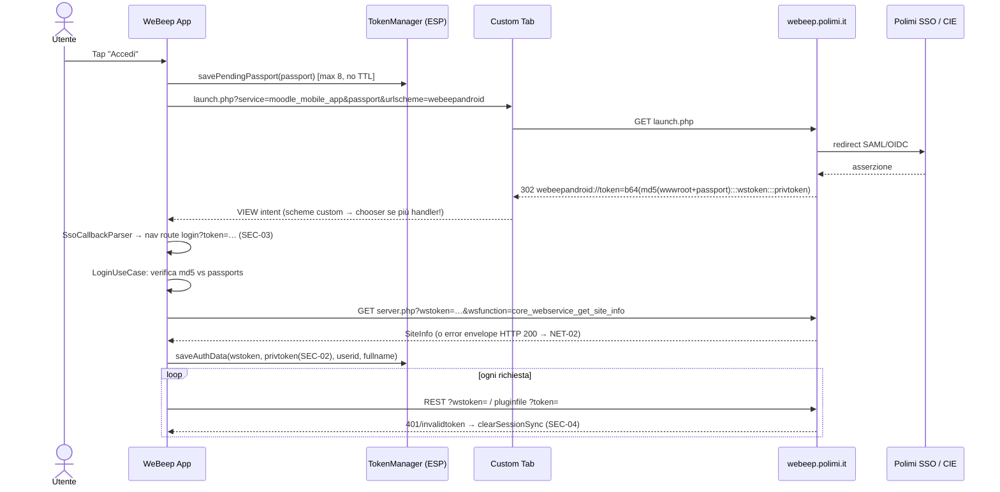

# Audit tecnico WeBeep Android — v1.0.1 (versionCode 2), commit `32abed4`

> **Contesto.** Audit richiesto su Frontend Android + integrazione Moodle/WeBeep. Tutto il codice sorgente di `app/` (~11,7k LOC Kotlin, 17 file di test) è stato letto per intero; ogni finding cita `file:linea` reali. Dove manca evidenza è indicato **NON VERIFICATO**. Nessun build/test è stato eseguito in questa sessione (sola lettura, plan mode).
>
> **Esecuzione proposta dopo approvazione:** salvare questo report come `docs/AUDIT-2026-09.md` sul branch `feature/festive-franklin-qcdhja`, commit + push. **Nessuna patch al codice verrà applicata senza tua conferma esplicita** (le patch sono pronte nella §6).

**Discrepanze tra architettura dichiarata e codice reale**
- `SsoCallbackRelay`, `LogRedactor`, `FileChangeDiff` **non esistono**. La redazione dei log è una lambda inline in `core/di/NetworkModule.kt:42-49`, il diff dei file è inline in `CourseSyncWorker.kt:76-94`.
- "blob SSO solo in memoria": **falso**. Il blob passa nelle route di navigazione (`WeBeepApp.kt:46`, `MainActivity.kt:109`) e `private_token` viene persistito (`TokenManager.kt:129-131`).
- "Hardening WebView": la WebView è **irraggiungibile** (vedi SEC-07).
- "Feature modules": c'è un solo modulo Gradle `:app` (`settings.gradle.kts:18`). Le "feature" sono package.

---

## 1. Executive Summary

L'app ha una base di sicurezza **sopra la media per un progetto studentesco**: cleartext disabilitato (`network_security_config.xml:3`), backup disattivato, token cifrati in EncryptedSharedPreferences, redazione dei log, `stripAuthFromUrl` usata in modo sistematico prima della persistenza, FileProvider non esportato, TLS fail-closed, R8 attivo e fail-fast sul keystore. L'architettura MVVM con StateFlow/Compose è coerente, e Coroutines/cancellation sono gestite con cura (rethrow di `CancellationException` ovunque).

I rischi principali sono:
- **integrità dei dati a riposo**: download in external storage, `private_token` persistito ma mai usato;
- **gestione di sessione incompleta**: il logout forzato su 401 non cancella i dati e non riporta al login;
- **token esposto nel ciclo di vita Android**: blob SSO in route di navigazione e nell'Intent;
- **robustezza dell'integrazione Moodle**: gli errori Moodle vengono deserializzati come successi grazie ai default dei DTO; bug nel `RetryInterceptor`;
- **performance**: crypto sul main thread, sync ogni 15 minuti più una sync completa a ogni `onCreate`, bitmap PDF da circa 18 MB.

Per Play mancano privacy policy e scansione delle dipendenze. Il package `it.polimi.*` e il nome "WeBeep" comportano un rischio di policy per impersonation.

**Top 5 rischi**
1. SEC-01: materiali del corso in `getExternalFilesDir`, leggibili da altre app su API 26–28.
2. SEC-04: logout forzato senza wipe di DB e file e senza ritorno al login (rischio dati tra utenti diversi).
3. SEC-03: blob SSO (wstoken + private token) nelle nav-args, nel saved state e nell'Intent, con replay a ogni recreate.
4. NET-02: una risposta di errore Moodle diventa un `SiteInfoDto` valido con `userid=0` e viene salvata come sessione.
5. SEC-05: hijacking dello scheme custom `webeepandroid`/`moodlemobile` (limite del protocollo SSO Moodle) e passport senza TTL.

**Top 5 quick-win (≤ 1h ciascuno)**
1. Usare `filesDir` al posto di `getExternalFilesDir` e togliere `external-files-path` (SEC-01).
2. Non salvare `private_token` e rimuoverlo dalle prefs esistenti (SEC-02).
3. Fix del `RetryInterceptor` (`lastResponse = null` dopo `close`) (NET-03).
4. `MainActivity`: processare il deep link solo se `savedInstanceState == null`, poi `intent.data = null`; sync immediata con `KEEP` (SEC-03, PERF-02).
5. `data_extraction_rules.xml`: escludere anche `external`/`root`; notifiche con `VISIBILITY_PRIVATE` (SEC-08, SEC-10).

---

## 2. Tabella findings (per severity)

| ID | Titolo | Sev | MASVS / ASVS | File:linea | Effort | P |
|---|---|---|---|---|---|---|
| SEC-01 | Download e viewer cache in external app storage | **High** | MASVS-STORAGE-1 | `DownloadRepositoryImpl.kt:216`, `FileViewerViewModel.kt:127`, `file_paths.xml:3` | S | P0 |
| SEC-02 | `private_token` (autologin) persistito e mai usato | Medium | MASVS-STORAGE-1, MASVS-PRIVACY-1 | `TokenManager.kt:129-131`, `LoginUseCase.kt:48` | S | P0 |
| SEC-03 | Blob SSO in nav-route, saved state e Intent; replay su recreate | Medium | MASVS-PLATFORM-1, MASVS-STORAGE-2 | `Screen.kt:10`, `WeBeepApp.kt:46`, `MainActivity.kt:54,108-113,123-130` | M | P0 |
| SEC-04 | Logout forzato (401/invalidtoken) senza wipe e senza navigazione | Medium | MASVS-AUTH-2, ASVS V3.3 | `TokenInterceptor.kt:58-80`, `TokenManager.kt:186-193` | M | P0 |
| NET-02 | Envelope errore Moodle non gestito; DTO con default mascherano errori | Medium | ASVS V13.1 / API8 | `SiteInfoDto.kt:8-22`, `NetworkModule.kt:119-123`, `LoginUseCase.kt:59-64` | M | P0 |
| SEC-05 | Custom-scheme hijack, collisione `moodlemobile`, passport senza TTL | Medium | MASVS-PLATFORM-1, MASVS-AUTH-1 | `AndroidManifest.xml:59-65`, `TokenManager.kt:195-208` | M | P1 |
| NET-01 | `wstoken` in query string su tutte le chiamate REST (GET) | Medium | MASVS-NETWORK-1, ASVS V3.1.1 | `MoodleApiService.kt:39-77`, `TokenInterceptor.kt:38-47` | M | P1 |
| NET-03 | `RetryInterceptor` può restituire una Response chiusa; retry bloccante e non cancellabile | Medium | ASVS V11 (resilienza) | `RetryInterceptor.kt:33-56` | S | P0 |
| PERF-01 | Crypto e Keystore (StrongBox) sul main thread all'avvio | Medium | — | `TokenManager.kt:52-55`, `MainActivity.kt:30-31` | M | P1 |
| PERF-02 | Sync di default ogni 15 minuti + sync completa `REPLACE` a ogni `onCreate` | Medium | — | `SettingsManager.kt:50`, `MainActivity.kt:76,95-100`, `SyncScheduler.kt:78-82` | S | P0 |
| PERF-03 | PdfViewer: bitmap 1800 px ARGB (~18 MB/pagina), apertura PDF sul main thread | Medium | — | `PdfViewer.kt:80-83,410-417` | M | P1 |
| BUILD-01 | Il fail-fast sul keystore si aggira con `assemble`/`build`/`bundle` | Medium | MASVS-CODE-1 | `app/build.gradle.kts:54-70` | S | P0 |
| SEC-06 | `security-crypto` deprecata (1.1.0-alpha06) | Medium | MASVS-CRYPTO-2 | `libs.versions.toml:10` | M | P2 |
| ARCH-01 | Clean Architecture non applicata (dipendenze invertite, modulo unico) | Medium | — | vedi dettaglio | L | P2 |
| TEST-01 | Test mancanti su interceptor, download, worker, migrazioni e UI; nessuna coverage | Medium | MASVS-CODE | `app/src/test/**` | M | P1 |
| BUILD-02 | Dipendenze datate, opt-out AGP 9, niente detekt/ktlint/dep-scan, CI non pinnata | Medium | MASVS-CODE-3 | `libs.versions.toml`, `gradle.properties:13-14`, `ci.yml` | M | P1 |
| PLAY-01 | Package `it.polimi.webeep` + brand WeBeep/Polimi: rischio impersonation; nessuna privacy policy | Medium | Play policy | `build.gradle.kts:15`, `strings.xml` | S | P0 (pre-publish) |
| NET-04 | Media: token in URL passato a ExoPlayer, bypassa interceptor e `no-store` | Low | MASVS-NETWORK-1 | `FileViewerViewModel.kt:80-83`, `MediaViewer.kt:54-56` | S | P2 |
| SEC-07 | WebView con JS irraggiungibile (dead code) che naviga verso qualsiasi host | Low | MASVS-PLATFORM-2 | `FileViewerViewModel.kt:94`, `FileViewerScreen.kt:465-473` | S | P1 |
| SEC-08 | `data_extraction_rules` non esclude `external`/`root` (D2D Android 12+) | Low | MASVS-STORAGE-2 | `data_extraction_rules.xml:2-13` | S | P1 |
| SEC-09 | `Log.e` non rimosso in release, con `e.message` e shortname del corso | Low | MASVS-STORAGE-2 | `CourseSyncWorker.kt:97,123`, `proguard-rules.pro:53-59` | S | P2 |
| SEC-10 | Nomi dei file e dei corsi visibili nelle notifiche sulla lock screen | Low | MASVS-PRIVACY | `CourseSyncWorker.kt:211-219` | S | P2 |
| PERF-04 | Mapping DTO→entity eseguito nel dispatcher del chiamante (Main) | Low | — | `CourseRepositoryImpl.kt:35-45`, `DashboardRepositoryImpl.kt:50-71` | S | P2 |
| CODE-01 | Messaggi tecnici non localizzati mostrati in UI; stringhe hardcoded | Low | MASVS-CODE | `GetCourseContentsUseCase.kt:42`, `DashboardViewModel.kt:57,153`, `FileViewerViewModel.kt:113` | S | P2 |
| CODE-02 | Cancellazione non propagata alle `Call` OkHttp; stato del download sovrascritto | Low | — | `FileViewerViewModel.kt:146-154`, `DownloadRepositoryImpl.kt:77-81`, `CourseDetailViewModel.kt:258-263` | S | P2 |
| UI-01 | Lingua per-app non persistita su API < 33 | Low | — | `SettingsScreen.kt:467-469`, `AndroidManifest.xml` | S | P2 |
| UI-02 | Inset hardcoded, logout senza conferma, permesso notifiche senza rationale | Low | — | `FileViewerScreen.kt:220`, `SettingsScreen.kt:210`, `MainActivity.kt:79-93` | S | P2 |
| DATA-01 | Nessun test delle migrazioni Room; la cache non degrada in release | Low | — | `DatabaseModule.kt:33-36` | S | P2 |
| SEC-11 | Nessun certificate pinning | Info | MASVS-NETWORK-2 (L2) | `network_security_config.xml` | — | P3 |
| ARCH-02 | Codice morto: `getCoursesByTimeline`, `TimelineCoursesResponseDto`, `wsToken` flow, `UNIQUE_WORK_NAME` | Info | — | `MoodleApiService.kt:18-22,56-68` | S | P3 |

---

## 3. Dettaglio findings

### SEC-01 — High — Materiali del corso in external storage
**Evidenza**
```kotlin
// DownloadRepositoryImpl.kt:215-217
private fun getDownloadsDirectory(): File {
    return context.getExternalFilesDir(DOWNLOADS_DIR) ?: File(context.filesDir, DOWNLOADS_DIR)
}
// FileViewerViewModel.kt:127
val downloadsDir = application.getExternalFilesDir("downloads") ?: File(application.filesDir, "downloads")
```
```xml
<!-- file_paths.xml:3 -->
<external-files-path name="downloads" path="downloads/" />
```

**Impatto.** La cartella `/sdcard/Android/data/it.polimi.webeep/files/downloads` non gode della sandbox di `/data/data`. Con `minSdk 26`, su API 26–28 qualsiasi app con `READ_EXTERNAL_STORAGE` può leggerla. È leggibile anche via adb, MTP o da file manager con accesso "All files". Questo contraddice il dichiarato "storage privato".

**Scenario.** Un'app malevola con permesso di storage su Android 9 esegue `File("/sdcard/Android/data/it.polimi.webeep/files/downloads").listFiles()` e sottrae dispense, esami e liste voti.

**Fix.** Vedi §6 P-SEC-01: usare solo `filesDir`, migrare i file esistenti, rimuovere `external-files-path`. Fonte: [Android — Data and file storage overview](https://developer.android.com/training/data-storage), MASTG-TEST-0200-series (storage).

### SEC-02 — Medium — `private_token` persistito senza uso
**Evidenza.** `LoginUseCase.kt:48` estrae `parts.getOrNull(2)`, poi `TokenManager.kt:129-131` esegue `putString(KEY_PRIVATE_TOKEN, privateToken)`. Una grep di `KEY_PRIVATE_TOKEN` non trova **nessuna lettura**.

**Impatto.** Il private token di Moodle abilita `tool_mobile_get_autologin_key`, quindi una sessione web completa. È un segreto in più a riposo, senza alcuno scopo (principio di minimizzazione, GDPR art. 5(1)(c)). Su un device rootato o compromesso amplia il danno.

**Fix.** Non salvarlo e cancellarlo dalle installazioni esistenti (§6 P-SEC-02).

### SEC-03 — Medium — Il blob SSO transita nel ciclo di vita Android
**Evidenza**
```kotlin
// Screen.kt:10
fun createRoute(token: String) = "login?token=${Uri.encode(token)}"
// WeBeepApp.kt:46
initialDeepLinkToken != null -> Screen.Login.createRoute(initialDeepLinkToken)
// MainActivity.kt:54 — rieseguito a ogni onCreate (rotazione, process death)
checkSsoDeepLink(intent)
```

**Impatto**
1. Il blob `md5:::wstoken:::private_token` finisce nel back stack di NavController, salvato nel `Bundle` di `onSaveInstanceState`, e resta nell'Intent dell'Activity. Il `TaskPersister` di sistema può scrivere su disco il base-intent del task.
2. Replay: dopo una rotazione, `onCreate` rilegge `intent.data`, rimette il token nella route e chiama di nuovo `handleSsoCallback`. Dopo un login riuscito i passport sono stati cancellati, quindi l'utente vede l'errore `SessionExpired` o una doppia validazione.
3. `onNewIntent` con `navController == null` (spinner iniziale) perde il token, perché `onNavControllerReady` imposta `pendingToken = null` (`MainActivity.kt:64`).

**Fix.** Relay in memoria (`Channel`), consumo una sola volta, `intent.data = null`, route Login senza argomenti (§6 P-SEC-03).

### SEC-04 — Medium — Il logout forzato non ripulisce e non naviga
**Evidenza.** `TokenInterceptor.kt:58-60` chiama `tokenProvider.clearSessionSync()`. Questo cancella solo le prefs (`TokenManager.kt:186-193`). Nessun componente osserva `isLoggedIn`: la grep mostra solo `WeBeepApp.kt:47` (`first()` una volta) e `LoginViewModel.kt:43`. Il wipe completo esiste solo in `AuthRepositoryImpl.logout()` (`:47-62`).

**Impatto.** Dopo la revoca del token l'utente resta sulla dashboard, con tutte le chiamate in errore. DB, download, `http_cache`, `image_cache` e cookie restano sul device. Se un altro studente fa login sullo stesso device, vede i corsi precedenti finché la sync non li sostituisce. I file già scaricati risultano "COMPLETED" se l'URL coincide (`CourseDetailViewModel.kt:258-262`).

**Fix.** Un `SessionExpiryHandler` app-scoped osserva `isLoggedIn` e alla transizione a `false` esegue `logout()` (idempotente) e naviga al login (§6 P-SEC-04).

### NET-02 — Medium — Gli errori Moodle diventano successi
**Evidenza.** Tutti i campi di `SiteInfoDto` hanno un default (`SiteInfoDto.kt:9-21`), e il parser è configurato con `ignoreUnknownKeys = true, coerceInputValues = true` (`NetworkModule.kt:119-123`). Moodle risponde **HTTP 200** con `{"exception":"…","errorcode":"…","message":"…"}`. Quell'oggetto si deserializza in `SiteInfoDto(userid=0, fullname="")` senza eccezioni.

**Scenario.** WS disabilitato, `servicerequireslogin` o token limitato per IP: `validateToken` ha successo, quindi `saveAuthData(token, userId=0)` e l'utente risulta "loggato". Poi `getUserId()` restituisce 0 (non -1, quindi non `null`), e `core_enrol_get_users_courses(userid=0)` fallisce con un errore opaco. Solo `invalidtoken` e `accessexception` sono intercettati (`TokenInterceptor.kt:27-30`).

**Fix.** Parsing esplicito dell'envelope di errore, con una `MoodleException(errorcode)` tipizzata, più `require(userid > 0)` (§6 P-NET-02).

### SEC-05 — Medium — Deep link a scheme custom
**Evidenza.** `AndroidManifest.xml:59-65`: `exported=true`, `webeepandroid` e `moodlemobile`. Il launch usa solo `urlscheme=webeepandroid` (`LoginUseCase.kt:88,100`). I passport restano validi fino al login riuscito (max 8, nessun timestamp: `TokenManager.kt:195-208`).

**Impatto**
- Uno scheme custom non è verificabile (diversamente dagli App Links). Un'app malevola che registra `webeepandroid` o `moodlemobile` fa comparire il chooser: se l'utente la sceglie, riceve wstoken e private token. È un limite intrinseco del flusso `tool_mobile/launch.php`.
- `moodlemobile` collide con l'app ufficiale Moodle: token destinati all'una possono essere offerti all'altra.
- Il passport ha entropia di 31 bit ed è controllato con MD5 (imposto dal protocollo). Il controllo protegge bene dal login-CSRF, ma senza TTL.

**Fix**
1. Rimuovere `moodlemobile` se Polimi non forza quello scheme (**NON VERIFICATO**: controllare `tool_mobile_forcedurlscheme` via `tool_mobile_get_config`).
2. Aggiungere un TTL di 10 minuti ai passport.
3. Rilevare altri handler dello scheme con `queryIntentActivities` e avvisare l'utente.
Fonte: MASTG "Testing Deep Links" (MASTG-TEST-0028); [Android — App Links](https://developer.android.com/training/app-links).

### NET-01 — Medium — Token nelle query REST
**Evidenza.** Ogni chiamata è `client.get(serverPath){ parameter(...) }` (`MoodleApiService.kt:40-76`), e `TokenInterceptor` aggiunge `?wstoken=` all'URL (`:42-45`). Il `no-store` evita la cache locale, ma il token resta nei log di accesso del server e di eventuali proxy o captive portal TLS-terminating, oltre che negli stack trace.

**Mitigazione.** `webservice/rest/server.php` accetta POST form (lo usa l'app ufficiale Moodle), quindi il token può viaggiare nel body. Per `pluginfile.php` il token in query è invece obbligatorio: resta quindi il mix attuale di `no-store`, host allow-list e redazione (§6 P-NET-01).

### NET-03 — Medium — Bug nel `RetryInterceptor`
**Evidenza**
```kotlin
// RetryInterceptor.kt:33-54
repeat(maxRetries) { attempt ->
    try {
        lastResponse?.close()                 // chiude r0...
        val response = chain.proceed(request) // ...ma se qui lancia IOException
        ...
        lastResponse = response
    } catch (e: IOException) { lastException = e }  // lastResponse punta ancora a r0 CHIUSA
    ...
}
lastResponse?.let { return it }               // ritorna una Response chiusa
```

**PoC.** Tentativo 1: 503. Tentativi 2 e 3: `SocketTimeoutException`. Il chiamante riceve la 503 già chiusa, e Ktor lancia `IllegalStateException: closed` invece di un errore di rete gestibile.

Inoltre `Thread.sleep` (max 3 s) blocca un thread del dispatcher OkHttp e ignora `call.isCanceled()`. Fix in §6 P-NET-03 (con test MockWebServer).

### PERF-01 — Medium — Keystore sul main thread
`MainActivity` inietta `TokenManager` con field injection (`MainActivity.kt:30-31`). Il suo `init` (`TokenManager.kt:52-55`) crea `MasterKey` con StrongBox e `EncryptedSharedPreferences`, con I/O e crypto su Keystore/StrongBox, prima del primo frame. StrongBox è notoriamente lento (centinaia di ms) e il fallback con due tentativi può raddoppiare il tempo: rischio di cold start lento o ANR su device low-end. Fix: inizializzazione lazy su IO (§6 P-PERF-01). Fonte: [App startup time](https://developer.android.com/topic/performance/vitals/launch-time).

### PERF-02 — Medium — Sync aggressiva
- Il default è `FIFTEEN_MINUTES` (`SettingsManager.kt:50`). Ogni run scarica `core_course_get_contents` per **tutti** i corsi (`CourseSyncWorker.kt:72-103`): costo di batteria e dati, oltre al carico sul server d'ateneo.
- `setupPeriodicSync()` viene chiamata a ogni `onCreate`, anche su rotazione (`MainActivity.kt:76`), e accoda `enqueueImmediate()` con `ExistingWorkPolicy.REPLACE` (`SyncScheduler.kt:78-82`). Ogni apertura o rotazione dell'app cancella e riavvia una sync completa.
- Nessun vincolo `setRequiresBatteryNotLow`.

Fix in §6 P-PERF-02.

### PERF-03 — Medium — PdfViewer
- Rendering HD a `HIGH_RES_WIDTH = 1800` in ARGB_8888 (`PdfViewer.kt:410-417`): una pagina A4 occupa 1800×2546×4 ≈ **18,3 MB**. La LRU è limitata a 24 MB (`:331`), ma i bitmap restano referenziati dai `produceState` degli item visibili (2–3 pagine, quindi circa 55 MB) e dai prefetch. Rischio OOM su heap da 256 MB insieme a Coil (15 %) e WebView.
- `ParcelFileDescriptor.open` e `PdfRenderer(...)` vengono eseguiti dentro `remember{}` sul main thread (`:80-83`), senza `try/catch`: un PDF corrotto fa crashare la composizione.
- `openPage(0)` per l'aspect ratio (`:89`) è chiamato fuori dal `pdfMutex`, mentre `PdfRenderer` non è thread-safe.

Fix: larghezza pari a `min(1800, larghezza schermo in px)`, apertura in `LaunchedEffect` su IO con stato di errore, tutto sotto `pdfMutex`.

### BUILD-01 — Medium — Bypass del fail-fast sul keystore
`releaseRequested` controlla se il **nome del task** contiene "Release" (`build.gradle.kts:55-57`). `./gradlew assemble`, `build` o `bundle` compilano anche la variante release, ma nessun nome contiene "Release": l'APK/AAB release viene **firmato debug senza errori né warning**. Fix: controllo in `doFirst` sui task di packaging e firma (§6 P-BUILD-01).

### SEC-06 — Medium — Jetpack Security Crypto deprecata
`securityCrypto = "1.1.0-alpha06"` (`libs.versions.toml:10`). La libreria è deprecata da Google (tutte le API sono marcate `@Deprecated` dalla 1.1.0-alpha07 / 1.1.0 del 2025) e non riceverà fix. Migrazione consigliata: Tink `Aead` con chiave nell'Android Keystore e ciphertext in DataStore (`noBackupFilesDir`). Effort M, con migrazione dati alla prima apertura. Fonte: [AndroidX Security release notes](https://developer.android.com/jetpack/androidx/releases/security).

### ARCH-01 — Medium — Clean Architecture dichiarata vs reale
- Esiste un solo modulo `:app`, quindi la regola delle dipendenze non è verificata dal compilatore.
- Il layer domain dipende da Android: `NetworkMonitor` (`android.net`) viene iniettato negli use case (`GetCoursesUseCase.kt:17`, `GetCourseContentsUseCase.kt:17`), e `Resource.Error(message: String)` porta stringhe UI nel domain.
- `DownloadFileUseCase`, `CourseRepositoryImpl` e `DashboardRepositoryImpl` dipendono da `TokenManager` concreto invece che da `TokenProvider`.
- I ViewModel scavalcano gli use case: `DashboardViewModel.kt:41-42,93,168` usa direttamente `dashboardRepository` e `authRepository`. `SyncCoursesUseCase` è un semplice pass-through.
- `AuthRepositoryImpl` (`:19-62`) fa da god-object: Room, WebView `CookieManager`, filesystem, WorkManager e un'altra feature (`DownloadRepository`). Usa inoltre `Dispatchers.IO` e `Main` hardcoded (`:50,54`) invece del qualifier.

**Fix incrementale**
1. Introdurre `SessionRepository.wipeLocalData()` in `core/data`.
2. Interfaccia `ConnectivityObserver` nel domain, con implementazione in `core/util`.
3. Error type sealed (`DataError`) al posto delle stringhe.
4. Eventuale split in `:core:*` e `:feature:*` in una fase successiva.

### TEST-01 — Medium — Coverage
Ci sono 17 test JVM ben scritti su `LoginUseCase`, interceptor, mapper e ViewModel. Mancano:
- test per `RetryInterceptor`, `NoStoreAuthCacheInterceptor`, `DownloadRepositoryImpl` (path traversal, eviction), `CourseSyncWorker` (`TestListenableWorkerBuilder`), `SyncScheduler`, `SettingsManager`;
- test delle migrazioni Room (`MigrationTestHelper` sugli schemi 1→4 già esportati);
- test UI Compose;
- un uso reale di Robolectric: la dipendenza è dichiarata (`build.gradle.kts:184`) ma nessun test usa `RobolectricTestRunner`;
- un tool di coverage (Kover/JaCoCo).

Solo 1 test strumentato (`TokenManagerTest`), non eseguito in CI.

### BUILD-02 — Medium — Toolchain e supply chain
- Opt-out AGP 9: `android.builtInKotlin=false`, `android.newDsl=false` (`gradle.properties:13-14`), e `kotlinOptions{}` deprecato (`build.gradle.kts:90-93`). Il rischio di rottura con la prossima major di AGP è **NON VERIFICATO**: controllare le release notes di AGP.
- Versioni datate al 2026-09: Compose BOM `2025.02.00`, lifecycle `2.8.7`, navigation `2.8.9`, coil `2.7.0` (Coil 3 disponibile), media3 `1.5.0`, appcompat `1.6.1`, Kotlin `2.1.0` con KSP1 `2.1.0-1.0.29`, androidx.test ext `1.1.5`. Le versioni "latest" esatte sono **NON VERIFICATE** offline.
- Detekt e ktlint non configurati: i comandi `./gradlew detekt dependencyCheck` **falliranno**, perché i plugin sono assenti.
- Nessun Dependabot/Renovate e nessuna scansione CVE: lo stato CVE è **NON VERIFICATO** ed è da verificare con osv-scanner o OWASP dependency-check.
- CI (`ci.yml`): action non pinnate per SHA, nessun blocco `permissions:`, nessuna `gradle/actions/wrapper-validation`.

### PLAY-01 — Medium (policy) — Pubblicazione
- `applicationId = "it.polimi.webeep"` (`build.gradle.kts:15`) usa il namespace di dominio del Politecnico. Con il nome "WeBeep" e il claim "Politecnico di Milano" nel login (`LoginScreen.kt:136`), rischia la policy *Impersonation/Misrepresentation* di Google Play. L'`applicationId` **non si può cambiare dopo la pubblicazione**. Consiglio: `io.github.<owner>.webeep` o simile, e un disclaimer "non ufficiale" nella UI (oggi è solo nel README, `:147`).
- Nessuna privacy policy nel repo, ma l'app tratta dati personali (nome, userid, avatar). La privacy policy e il Data Safety form sono obbligatori.

### NET-04 — Low — Token nell'URL passato a ExoPlayer
`FileViewerUiState.Media(url = buildAuthenticatedUrl(url, token))` (`FileViewerViewModel.kt:81-83`) arriva a `DefaultHttpDataSource`, che è fuori da OkHttp: niente redazione, niente allow-list per host sui redirect, e il token resta nello UiState. Fix: `androidx.media3:media3-datasource-okhttp` con `OkHttpDataSource.Factory(okHttpClient)` e URL senza token; lo aggiunge `PluginFileAuthInterceptor`.

### SEC-07 — Low — WebView irraggiungibile
In `FileViewerViewModel.load()` ogni URL http(s) che non punta a pluginfile va in `CustomTab` (`:66-69,119-123`). Per pluginfile con `mimeType = "text/html"` vale prima `isCodeFile`, perché `mimeType.startsWith("text/")` è vero (`:85,189`). Il ramo `mimeType == "text/html" -> Web(url)` (`:94`) è quindi **irraggiungibile**. Il codice resta nel binario con JS attivo e `shouldOverrideUrlLoading` che accetta qualsiasi host (`FileViewerScreen.kt:471-473`). Anche se fosse raggiungibile, la WebView caricherebbe pluginfile **senza token** (`:502-504`) e mostrerebbe errore. Fix: rimuovere `WebContent` e lo stato `Web`. Il "hardening WebView" del README va aggiornato.

### SEC-08 — Low — Estrazione dati
`allowBackup=false` **non** disabilita il device-to-device transfer su Android 12+: valgono le `dataExtractionRules`, che escludono solo `sharedpref`, `database` e `file`. Aggiungere `external`, `root` e i domini `device_*`. Fonte: [Back up user data — data extraction rules](https://developer.android.com/guide/topics/data/autobackup#include-exclude-android-12).

### SEC-09 — Low — Log in release
`-assumenosideeffects` rimuove `v/d/i/w` ma non `e` (`proguard-rules.pro:53-59`). `CourseSyncWorker.kt:97,123` logga `course.shortname` ed `e.message`. Il token non è nell'URL a livello Ktor, perché lo aggiunge l'interceptor OkHttp più in basso. Fanno eccezione le chiamate con `wstoken` esplicito (solo la validazione al login), che però non vengono loggate. Rischio basso: loggare solo `e::class.simpleName` e `course.id`.

### SEC-10 — Low — Notifiche sulla lock screen
`CourseSyncWorker.kt:211-219`: nomi dei file e dei corsi senza `setVisibility(VISIBILITY_PRIVATE)` né `setPublicVersion`.

### PERF-04 — Low — Mapping sul Main
`CourseContentMapper.map` (con regex `mlang` e unescape) viene eseguito nel contesto del collector, cioè `viewModelScope` = Main (`CourseRepositoryImpl.kt:35-38`). Ktor e Room sono main-safe, il mapping no. Avvolgerlo in `withContext(defaultDispatcher)`.

### CODE-01 — Low — Messaggi d'errore
- `throwable.localizedMessage` finisce in UI (`GetCourseContentsUseCase.kt:42`, `GetCoursesUseCase.kt:49`, `DashboardViewModel.kt:153`, `FileViewerViewModel.kt:113`, `MediaViewer.kt:59`): testi Ktor/OkHttp in inglese tecnico, o "Token non disponibile" in italiano fisso (`DashboardRepositoryImpl.kt:39`).
- `userName = "Studente"` è hardcoded (`DashboardViewModel.kt:57`).
- Fix: mappare un `DataError` sealed a `R.string.*`, come già fatto correttamente per `LoginError`.

### CODE-02 — Low — Cancellazione e stato dei download
- `okHttpClient.newCall(request).execute()` dentro una coroutine (`FileViewerViewModel.kt:147`): uscendo dallo schermo la coroutine viene cancellata, la `Call` no, e il download continua.
- In `DownloadRepositoryImpl` c'è una race: `calls[id] = call` viene assegnato dopo il `launch` (`:80-81`), quindi un `cancelDownload` immediato non ferma la rete.
- `getDownloadProgress` rimuove lo state al termine (`:136`), quindi un secondo collector riceve -1.
- Il ri-emit della cache dopo una sync ricostruisce i `FileUiModel` e riporta un download in corso a `NOT_STARTED` (`CourseDetailViewModel.kt:258-263`).

Fix: `suspendCancellableCoroutine` con `invokeOnCancellation { call.cancel() }`, oppure `executeAsync()` di OkHttp 5.

### UI-01 — Low — Lingua per-app
`AppCompatDelegate.setApplicationLocales` (`SettingsScreen.kt:467-469`) su API ≤ 32 richiede il service `AppLocalesMetadataHolderService` con `autoStoreLocales=true`, che è assente nel manifest: la scelta si perde al riavvio. Fonte: [Per-app language preferences](https://developer.android.com/guide/topics/resources/app-languages#androidx-impl).

### UI-02 — Low — UX e a11y minori
- `padding(top = 40.dp)` hardcoded (`FileViewerScreen.kt:220`): usare `WindowInsets.safeDrawing`.
- Il logout parte con un solo tap, senza dialog di conferma (`SettingsScreen.kt:210`).
- Il permesso notifiche viene chiesto al primo avvio, prima del login e senza rationale (`MainActivity.kt:79-93`).
- `contentDescription` dell'icona Login ridondante con il testo del bottone (`LoginScreen.kt:230`): va messa a `null`.

Aspetti positivi:
- `bouncyClickable` applica `minimumInteractiveComponentSize()` e `Role.Button` (`BouncyClickable.kt:36,80`);
- reduce-motion rispettato;
- edge-to-edge attivo (`MainActivity.kt:52`);
- dynamic color su S+;
- predictive back attivo di default con target 36.

Il contrasto testo/sfondo della card translucida su `AuroraBackground` è **NON VERIFICATO**: misurare con Accessibility Scanner.

### DATA-01 — Low — Room
Le migrazioni sono corrette e lo schema è esportato (1–4), ma **non testate**. `fallbackToDestructiveMigration` è attivo solo in DEBUG (`DatabaseModule.kt:34-36`). Poiché il DB è una cache ricostruibile, in release conviene almeno `fallbackToDestructiveMigrationOnDowngrade(dropAllTables = true)`, per evitare un crash all'avvio dopo un rollback di versione.

### SEC-11 — Info — Pinning
L'assenza di pinning è **accettabile**: MASVS-NETWORK-2 è un requisito L2. Il certificato di un host universitario ruota fuori dal controllo dello sviluppatore, e il pinning rischierebbe un blocco totale. Se si decide di adottarlo, pinnare la CA intermedia più un backup con `<pin-set expiration>`. Il supporto a Certificate Transparency via NSC su Android 16 è **NON VERIFICATO**.

---

## 4. Backend-Integration (Moodle / WeBeep)

### 4.1 Endpoint usati

| Endpoint / wsfunction | Chiamante | Parametri | Auth | Note |
|---|---|---|---|---|
| `admin/tool/mobile/launch.php` | `LoginUseCase.buildSsoLaunchUrl` (`:96-100`) | `service=moodle_mobile_app`, `passport`, `urlscheme=webeepandroid` | SSO nel browser (Custom Tab) | redirect `webeepandroid://token=<b64(md5:::wstoken:::privatetoken)>` |
| `core_webservice_get_site_info` | `AuthRepositoryImpl.validateToken` (`:30`), `DashboardRepositoryImpl.getUserInfo/syncCourses` (`:43,80`) | — | `wstoken` in query (esplicito pre-login, poi via interceptor) | a ogni apertura della Dashboard (`DashboardViewModel.kt:87`) |
| `core_enrol_get_users_courses` | `DashboardRepositoryImpl.syncCourses` (`:48`) | `userid` | `wstoken` in query | errore se `userid=0` (NET-02) |
| `core_course_get_contents` | `CourseRepositoryImpl.getCourseContents` (`:37`), worker | `courseid` | `wstoken` in query | chiamato N volte a ogni sync (PERF-02) |
| `core_course_get_enrolled_courses_by_timeline_classification` | **nessuno** (dead code) | — | — | ARCH-02 |
| `webservice/pluginfile.php/...` | Download, FileViewer, Coil, ExoPlayer | — | `token` in query (`PluginFileAuthInterceptor`; `buildAuthenticatedUrl` per ExoPlayer) | `no-store`, solo `webeep.polimi.it` |

**Ordine degli interceptor** (`NetworkModule.kt:95-105`): `Retry → PluginFileAuth → Token → Logging(app)`, poi `NoStoreAuthCache(network)`. È corretto: il retry include la re-iniezione del token, il logging vede l'URL finale (redatto), `no-store` è applicato prima della cache. Timeout 30 s ×3. Logging `NONE` in release.

### 4.2 Sequence diagram del flusso di autenticazione


### 4.3 Rischi del token nell'URL e mitigazioni
| Vettore | Stato attuale | Mitigazione |
|---|---|---|
| Cache HTTP su disco | ✅ `no-store` forzato (`NoStoreAuthCacheInterceptor.kt:20-27`) | — |
| Log applicativi | ✅ regex di redazione (`NetworkModule.kt:43-47`), logging `NONE` in release | Test unitario sulla regex di redazione |
| Persistenza (Room, nav-args) | ✅ `stripAuthFromUrl` sistematico. ❌ blob SSO nelle nav-args | P-SEC-03 |
| Log di server/proxy (REST) | ❌ GET con token in query | P-NET-01: POST form per `server.php` |
| Header `Referer` verso terzi | ✅ niente WebView attiva; i Custom Tab ricevono URL senza token | Rimuovere la WebView (SEC-07) |
| Host non attendibili | ✅ allow-list `webeep.polimi.it` e HTTPS | Mantenere; aggiungere test su redirect cross-host |
| ExoPlayer | ⚠️ URL con token fuori da OkHttp | P-NET-04 |
| Stack trace e messaggi d'errore | ⚠️ `localizedMessage` mostrato in UI (il token non c'è nell'URL Ktor, tranne pre-login) | CODE-01 |

---

## 5. Roadmap

**P0 (48 h)**: SEC-01, SEC-02, SEC-03, SEC-04, NET-02, NET-03, PERF-02, BUILD-01, PLAY-01 (decisione sull'`applicationId` prima del primo publish).

**P1 (2 settimane)**: SEC-05, NET-01, PERF-01, PERF-03, SEC-07, SEC-08, TEST-01, BUILD-02 (detekt, ktlint, Dependabot, osv-scanner, Kover).

**P2 (backlog)**: SEC-06 (migrazione Tink), ARCH-01, NET-04, SEC-09, SEC-10, PERF-04, CODE-01/02, UI-01/02, DATA-01, Baseline Profile.

**P3**: SEC-11, ARCH-02.

**Matrice effort/impatto**
| | Effort S | Effort M | Effort L |
|---|---|---|---|
| **Impatto alto** | SEC-01, SEC-02, NET-03, BUILD-01, PERF-02 | SEC-03, SEC-04, NET-02, NET-01, PERF-01 | ARCH-01 (split in moduli) |
| **Impatto medio** | SEC-07, SEC-08, PLAY-01 | SEC-05, PERF-03, TEST-01, BUILD-02, SEC-06 | — |
| **Impatto basso** | SEC-09, SEC-10, PERF-04, UI-01/02, CODE-01/02, DATA-01 | NET-04 | — |

---

## 6. Patch suggerite (pronte, non ancora applicate)

### P-SEC-01 — `DownloadRepositoryImpl.kt`, `FileViewerViewModel.kt`, `file_paths.xml`
```kotlin
// DownloadRepositoryImpl.kt — before
private fun getDownloadsDirectory(): File {
    return context.getExternalFilesDir(DOWNLOADS_DIR) ?: File(context.filesDir, DOWNLOADS_DIR)
}
// after
private val downloadsDir: File by lazy {
    File(context.filesDir, DOWNLOADS_DIR).also { dir ->
        dir.mkdirs()
        // One-shot migration from the legacy external location.
        context.getExternalFilesDir(DOWNLOADS_DIR)?.listFiles()?.forEach { legacy ->
            if (!legacy.name.endsWith(".part")) {
                val target = File(dir, legacy.name)
                if (!target.exists()) runCatching { legacy.copyTo(target) }
            }
            legacy.delete()
        }
    }
}
private fun getDownloadsDirectory(): File = downloadsDir
```
```kotlin
// FileViewerViewModel.kt:127 — after
val downloadsDir = File(application.filesDir, "downloads")
```
```xml
<!-- file_paths.xml — remove the external-files-path line -->
<paths>
    <files-path name="internal_downloads" path="downloads/" />
    <cache-path name="viewer_cache" path="viewer/" />
</paths>
```
*Nota:* la migrazione esegue I/O su disco: chiamarla solo da `ioDispatcher`. Tutti gli usi attuali sono già dentro `scope.launch` o su IO, tranne `isFileDownloaded`/`getDownloadedFileUri`, chiamati da `CourseDetailViewModel` dentro `withContext(ioDispatcher)` (`:308`) e da `openFile` sul Main. Per questo conviene un `warmUp()` su IO all'avvio.

### P-SEC-02 — `TokenManager.kt`, `LoginUseCase.kt`
```kotlin
// TokenManager.saveAuthData — before
if (privateToken != null) {
    editor.putString(KEY_PRIVATE_TOKEN, privateToken)
}
// after: never persist the autologin-capable private token
editor.remove(KEY_PRIVATE_TOKEN)
```
```kotlin
// LoginUseCase.kt:47-50 — after
val wsToken = parts[1]
wsToken to null  // private token intentionally discarded (data minimization)
```
(Poi, in un follow-up, rimuovere il parametro `privateToken` da `TokenProvider`, `AuthRepository` e dai test.)

### P-SEC-03 — relay SSO in memoria (nuovo file `feature/auth/domain/SsoCallbackRelay.kt`)
```kotlin
@Singleton
class SsoCallbackRelay @Inject constructor() {
    private val channel = Channel<String>(Channel.CONFLATED)
    val tokens: Flow<String> = channel.receiveAsFlow()
    fun offer(token: String) { channel.trySend(token) }
}
```
```kotlin
// MainActivity — after
@Inject lateinit var ssoCallbackRelay: SsoCallbackRelay

override fun onCreate(savedInstanceState: Bundle?) {
    super.onCreate(savedInstanceState)
    enableEdgeToEdge()
    val openLogin = savedInstanceState == null && consumeSsoDeepLink(intent)
    if (savedInstanceState == null) checkCourseIntent(intent)
    setContent { WeBeepApp(tokenManager, settingsManager, forceLogin = openLogin, onNavControllerReady = { ... }) }
    if (savedInstanceState == null) checkAndRequestNotificationPermission()
}

override fun onNewIntent(intent: Intent) {
    super.onNewIntent(intent)
    if (consumeSsoDeepLink(intent)) {
        navController?.navigate(Screen.Login.route) {
            popUpTo(0) { inclusive = true }; launchSingleTop = true
        }
    }
    checkCourseIntent(intent)
    ...
}

private fun consumeSsoDeepLink(intent: Intent?): Boolean {
    val data = intent?.data ?: return false
    if (data.scheme !in SSO_CALLBACK_SCHEMES) return false
    val token = SsoCallbackParser.extractToken(data)
    intent.data = null          // do not keep the blob in the Activity intent
    setIntent(intent)
    token?.let(ssoCallbackRelay::offer)
    return token != null
}
```
```kotlin
// LoginViewModel — after (inject SsoCallbackRelay)
init {
    viewModelScope.launch { ssoCallbackRelay.tokens.collect(::handleSsoCallback) }
    viewModelScope.launch { if (authRepository.isLoggedIn()) _uiState.update { LoginUiState.Success } }
}
```
Rimuovere `Screen.Login.routeWithToken`, `createRoute(token)`, il composable con argomento (`NavGraph.kt:104-117`) e `LoginEntry(token)`.

### P-SEC-04 — logout forzato (nuovo `core/session/SessionExpiryHandler.kt` + `WeBeepApp`)
```kotlin
@Singleton
class SessionExpiryHandler @Inject constructor(
    private val tokenProvider: TokenProvider,
    private val authRepository: AuthRepository
) {
    /** Emits once each time an authenticated session is lost (401/invalidtoken or manual logout). */
    val sessionLost: Flow<Unit> = tokenProvider.isLoggedIn
        .runningFold(false to false) { (_, prev), now -> prev to now }
        .filter { (prev, now) -> prev && !now }
        .map { authRepository.logout() }   // idempotent full wipe
}
```
```kotlin
// WeBeepApp — inside the else branch, next to onNavControllerReady
LaunchedEffect(navController) {
    sessionExpiryHandler.sessionLost.collect {
        navController.navigate(Screen.Login.route) {
            popUpTo(0) { inclusive = true }; launchSingleTop = true
        }
    }
}
```
(`AuthRepositoryImpl.logout()` è già idempotente: operazioni `runCatching`/`deleteQuietly`.)

### P-NET-02 — envelope di errore Moodle (`core/network/MoodleError.kt` + `MoodleApiServiceImpl`)
```kotlin
@Serializable
data class MoodleErrorDto(
    val exception: String? = null,
    val errorcode: String? = null,
    val message: String? = null
)
class MoodleException(val errorCode: String, message: String?) : IOException(message)

// MoodleApiServiceImpl
private val json = Json { ignoreUnknownKeys = true; coerceInputValues = true }

private suspend inline fun <reified T> HttpResponse.moodleBody(): T {
    val element = json.parseToJsonElement(bodyAsText())
    if (element is JsonObject && ("exception" in element || "errorcode" in element)) {
        val err = json.decodeFromJsonElement<MoodleErrorDto>(element)
        throw MoodleException(err.errorcode ?: "unknown", err.message)
    }
    return json.decodeFromJsonElement(element)
}

override suspend fun getSiteInfo(wsToken: String?): SiteInfoDto =
    client.get(serverPath) { /* same params */ }.moodleBody<SiteInfoDto>()
        .also { require(it.userid > 0) { "Invalid site info" } }
```
Stesso pattern `.moodleBody<…>()` per le altre funzioni. In `LoginViewModel` mappare `MoodleException` a una stringa localizzata.

### P-NET-03 — `RetryInterceptor.kt`
```kotlin
// after
repeat(maxRetries) { attempt ->
    lastResponse?.close()
    lastResponse = null
    if (chain.call().isCanceled()) throw IOException("Canceled")
    try {
        val response = chain.proceed(request)
        if (response.code !in 500..599) return response
        lastResponse = response
    } catch (e: IOException) {
        lastException = e
    }
    if (attempt < maxRetries - 1) {
        try {
            Thread.sleep(initialDelayMs * (1L shl attempt))
        } catch (e: InterruptedException) {
            Thread.currentThread().interrupt()
            throw IOException("Retry interrupted", e)
        }
    }
}
lastResponse?.let { return it }
throw lastException ?: IOException("Max retries ($maxRetries) exceeded")
```
Test (MockWebServer): accodare `503`, poi `SocketPolicy.DISCONNECT_AT_START` ×2, e verificare che venga lanciata `IOException` e non una Response chiusa.

### P-NET-01 — REST via POST (M)
```kotlin
// MoodleApiServiceImpl (inject TokenProvider)
private suspend inline fun <reified T> ws(
    function: String, explicitToken: String? = null, crossinline extra: ParametersBuilder.() -> Unit = {}
): T = client.submitForm(
    url = serverPath,
    formParameters = parameters {
        (explicitToken ?: tokenProvider.getTokenSync())?.let { append("wstoken", it) }
        append("wsfunction", function)
        append("moodlewsrestformat", "json")
        extra()
    }
) { header(READ_ONLY_WS_HEADER, "1") }.moodleBody()
```
Modifiche collegate:
- `TokenInterceptor`: niente più iniezione in query per `server.php`; resta solo il rilevamento 401/invalidtoken.
- `RetryInterceptor`: consentire il retry dei POST marcati con `READ_ONLY_WS_HEADER` (tutte le funzioni usate sono read-only), rimuovendo l'header prima di `proceed`.
- Aggiornare i test `MoodleApiServiceTest`/`TokenInterceptorTest`.

### P-PERF-01 — `TokenManager.kt`
```kotlin
// before: init { encryptedPrefs = createEncryptedPrefsWithFallback(application); refreshCacheFromPrefs() }
// after
private val encryptedPrefs: SharedPreferences by lazy { createEncryptedPrefsWithFallback(application) }
private val loaded = java.util.concurrent.atomic.AtomicBoolean(false)

suspend fun ensureLoaded() = withContext(ioDispatcher) {
    if (loaded.compareAndSet(false, true)) synchronized(clearLock) { refreshCacheFromPrefs() }
}
```
- `WeBeepApp.kt:44-50`: chiamare `tokenManager.ensureLoaded()` prima di `isLoggedIn.first()`.
- `WeBeepApplication.onCreate`: `ProcessLifecycleOwner.get().lifecycleScope.launch { tokenManager.ensureLoaded() }` come warm-up.
- `getToken()`/`saveAuthData`/`clear*`: già su IO, la lazy si inizializza lì.
- Rischio: `getTokenSync()` restituisce `null` prima del load. È accettabile, perché i repository chiamano sempre `getToken()` (suspend, che popola la cache) prima delle richieste.

### P-PERF-02 — `MainActivity.kt`, `SyncScheduler.kt`, `SettingsManager.kt`
```kotlin
// MainActivity.onCreate — only on a fresh start
if (savedInstanceState == null) checkAndRequestNotificationPermission()
// SyncScheduler.enqueueImmediate — before: ExistingWorkPolicy.REPLACE
workManager.enqueueUniqueWork(UNIQUE_ONE_SHOT_WORK, ExistingWorkPolicy.KEEP, request)
// SyncScheduler.networkConstraints
Constraints.Builder().setRequiredNetworkType(networkType).setRequiresBatteryNotLow(true).build()
// SettingsManager.kt:50 and SettingsUiState default
?: SyncFrequency.ONE_HOUR
```

### P-BUILD-01 — `app/build.gradle.kts`
```kotlin
// replace lines 49-70
val releaseSigning = signingConfigs.getByName("release")
val hasReleaseKeystore = releaseSigning.storeFile?.exists() == true
val allowDebugFallback = System.getenv("ALLOW_DEBUG_RELEASE_SIGNING") == "true"
signingConfig = if (hasReleaseKeystore) releaseSigning else signingConfigs.getByName("debug")
```
```kotlin
// after the android {} block (configuration-cache safe: captures only Booleans)
val hasReleaseKeystoreForCheck = System.getenv("KEYSTORE_FILE")?.let { file(it).exists() } == true
val allowDebugReleaseSigning = System.getenv("ALLOW_DEBUG_RELEASE_SIGNING") == "true"
tasks.matching { it.name in setOf("packageRelease", "signReleaseBundle") }.configureEach {
    doFirst {
        if (!hasReleaseKeystoreForCheck && !allowDebugReleaseSigning) {
            throw GradleException("Missing release keystore (KEYSTORE_FILE…) — set ALLOW_DEBUG_RELEASE_SIGNING=true only for CI smoke builds.")
        }
    }
}
```

### P-SEC-07 — rimozione della WebView
- `FileViewerViewModel.kt:94`: eliminare il ramo `mimeType == "text/html" -> FileViewerUiState.Web(url)` e il data class `Web`.
- `FileViewerScreen.kt`: eliminare `WebContent` (`:412-528`), il caso `is FileViewerUiState.Web` (`:193`) e l'import di `SslErrorHandler`.
- Aggiornare il README (`:78,140`).

### P-SEC-08 — `data_extraction_rules.xml`
```xml
<data-extraction-rules>
    <cloud-backup>
        <exclude domain="root" path="." />
        <exclude domain="file" path="." />
        <exclude domain="database" path="." />
        <exclude domain="sharedpref" path="." />
        <exclude domain="external" path="." />
    </cloud-backup>
    <device-transfer>
        <exclude domain="root" path="." />
        <exclude domain="file" path="." />
        <exclude domain="database" path="." />
        <exclude domain="sharedpref" path="." />
        <exclude domain="external" path="." />
    </device-transfer>
</data-extraction-rules>
```

### P-SEC-05 — passport con TTL (`TokenManager`)
```kotlin
// store "passport|epochMillis"; filter on read
private const val PASSPORT_TTL_MS = 10 * 60_000L
private fun readPassportList(): List<String> {
    val now = System.currentTimeMillis()
    return encryptedPrefs.getString(KEY_PENDING_PASSPORTS, null).orEmpty()
        .split('\n').mapNotNull { line ->
            val (p, ts) = line.split('|').let { it.getOrNull(0) to it.getOrNull(1)?.toLongOrNull() }
            p?.takeIf { ts != null && now - ts < PASSPORT_TTL_MS }
        }
}
```
Manifest: rimuovere `<data android:scheme="moodlemobile" />` dopo aver verificato `tool_mobile_forcedurlscheme` (**NON VERIFICATO**).

### P-SEC-09 / P-SEC-10 — worker
```kotlin
Log.e("CourseSyncWorker", "Sync error course=${course.id} type=${e::class.simpleName}")
// notification builder
.setVisibility(NotificationCompat.VISIBILITY_PRIVATE)
.setPublicVersion(
    NotificationCompat.Builder(appContext, channelId)
        .setSmallIcon(R.drawable.ic_stat_notify)
        .setContentTitle(appContext.getString(R.string.sync_completed_title))
        .build()
)
```

### P-UI-01 — `AndroidManifest.xml` (dentro `<application>`)
```xml
<service
    android:name="androidx.appcompat.app.AppLocalesMetadataHolderService"
    android:enabled="false"
    android:exported="false">
    <meta-data android:name="autoStoreLocales" android:value="true" />
</service>
```

### P-PERF-04 — repository
```kotlin
val dtos = apiService.getCourseContents(courseId = courseId)
val mapped = withContext(defaultDispatcher) { CourseContentMapper.map(courseId, dtos) }
```

---

## 7. Verifiche

**Comandi disponibili oggi**
```bash
./gradlew :app:lintDebug :app:lintRelease       # lint (abortOnError=true)
./gradlew testDebugUnitTest                     # 17 test JVM
./gradlew :app:assembleRelease                  # R8 + verifica signing (senza keystore deve FALLIRE)
./gradlew assemble                              # oggi NON fallisce senza keystore → BUILD-01
./gradlew :app:connectedDebugAndroidTest        # TokenManagerTest (richiede device/emulatore)
unzip -l app/build/outputs/apk/release/*.apk | grep '\.so$'   # verifica 16 KB page size (se presenti .so)
```
**Da aggiungere prima di poter lanciare** `detekt`/`dependencyCheck` (i plugin oggi non sono configurati):
- `io.gitlab.arturbosch.detekt`;
- `org.jlleitschuh.gradle.ktlint`;
- `org.owasp.dependencycheck` oppure `google/osv-scanner-action` in CI;
- `org.jetbrains.kotlinx.kover`;
- `.github/dependabot.yml` (gradle + github-actions);
- in CI: `gradle/actions/wrapper-validation`, `permissions: contents: read`, action pinnate per SHA.

**Test da aggiungere**
- `RetryInterceptorTest`: 503 poi disconnect ×2 → `IOException`; 5xx ×3 → ultima Response aperta; nessun retry su POST non marcato.
- `NoStoreAuthCacheInterceptorTest`: una Response con `?token=` non finisce in `Cache`.
- Test della redazione del logging: le regex coprono `wstoken=`, `token=`, `private_token=`, anche nel body form.
- `MoodleApiServiceTest`: l'error envelope su HTTP 200 → `MoodleException`; `SiteInfo` con `userid=0` → errore.
- `DownloadRepositoryImplTest` (Robolectric): path traversal `../`, eviction a 500 MB, cancel prima di `execute`, directory in `filesDir`.
- `CourseSyncWorkerTest` (`TestListenableWorkerBuilder` + fake): diff dei nuovi file → notifica; nessun token → `failure`; errori parziali → `success`.
- `MigrationTest` (`MigrationTestHelper`): 1→2→3→4 con dati.
- `SessionExpiryHandlerTest` (Turbine): transizione true→false → `logout()` chiamato una volta.
- `LoginUseCaseTest`: passport scaduto (TTL) → `SessionExpired`.
- Compose UI test: login → error snackbar; dashboard empty/error/offline; `FileViewer` in stato di errore.

**Benchmark**
- Modulo `:baselineprofile` con `androidx.benchmark.macro`: `StartupBenchmark` (cold/warm, `StartupMode.COLD`) prima e dopo P-PERF-01, poi generare il Baseline Profile (`profileinstaller`).
- `FrameTimingMetric` su scroll della Dashboard, espansione sezioni in CourseDetail e scroll di un PDF da 100 pagine.
- Memoria: Android Studio Profiler / `dumpsys meminfo` durante lo scroll PDF, prima e dopo PERF-03.
- WorkManager: `adb shell dumpsys jobscheduler | grep it.polimi.webeep` per verificare la frequenza dopo P-PERF-02.

---

## 8. Score (0–100)

| Area | Score | Motivazione |
|---|---|---|
| Architettura | **64** | Package per feature, DI Hilt pulita, MVVM + StateFlow coerente, UiState sealed. Però un solo modulo, domain con dipendenze Android, ViewModel che scavalcano gli use case e un `AuthRepositoryImpl` che fa da god-object. |
| Codice | **72** | Kotlin idiomatico: sealed, `data object`, `CancellationException` rilanciata, `@Immutable` sui modelli UI. Ci sono però bug concreti (retry, default dei DTO, race nei download), codice morto (WebView, timeline) e stringhe hardcoded. |
| UI | **74** | M3, dark/dynamic, edge-to-edge, reduce-motion, haptics, target 48 dp, `contentDescription` localizzate, lingue it/en complete (98/98). Mancano insets corretti, errori localizzati e persistenza della lingua su API < 33. |
| Performance | **58** | Crypto sul main all'avvio, sync ogni 15 minuti più `REPLACE` a ogni `onCreate`, bitmap PDF da 18 MB, mapping sul Main, nessun Baseline Profile. Positivi LRU e prefetch del PDF e `flowOn`. |
| Sicurezza | **68** | Baseline solida: NSC, backup off, ESP, redazione, `stripAuth`, FileProvider privato, TLS fail-closed, R8. Pesano però external storage, `private_token` inutile, blob in nav/Intent, logout forzato incompleto e libreria crypto deprecata. |
| Backend-Integration | **66** | Uso corretto delle wsfunction e interceptor ben ordinati, con allow-list per host e `no-store`. Restano token in GET, error envelope ignorato, bug del retry e carico di sync elevato. |
| Test | **55** | 17 test JVM mirati su auth e network, MockWebServer e Turbine. Nessun test di migrazione, worker, download, UI; Robolectric inutilizzato; nessuna coverage. |
| Build/DevEx | **62** | Version catalog, R8, fail-fast (aggirabile), lint `abortOnError`, CI con test e build release smoke. Mancano detekt/ktlint/dep-scan/Dependabot; opt-out AGP 9 e dipendenze datate. |

---

## 9. Checklist Play-ready (PASS/FAIL)

| Check | Esito | Note |
|---|---|---|
| targetSdk 36 (requisito Play 2026) | **PASS** | `build.gradle.kts:17` |
| Solo componenti esportati necessari | **PASS** | solo `MainActivity`; FileProvider e startup non esportati |
| Cleartext disabilitato | **PASS** | `network_security_config.xml:3` |
| Backup / D2D | **PARTIAL** | `allowBackup=false`; mancano `external`/`root` (SEC-08) |
| Credenziali cifrate a riposo | **PASS (con debito)** | ESP e StrongBox; lib deprecata (SEC-06); `private_token` superfluo (SEC-02) |
| Dati utente solo in storage interno | **FAIL** | SEC-01 |
| Gestione della sessione (revoca → wipe) | **FAIL** | SEC-04 |
| Log sensibili rimossi in release | **PARTIAL** | `Log.e` presente (SEC-09) |
| R8 / minify / shrinkResources | **PASS** | `build.gradle.kts:43-44` |
| Firma release obbligatoria | **PARTIAL** | bypass con `assemble`/`bundle` (BUILD-01) |
| Permesso notifiche runtime (API 33+) | **PASS** | con UX migliorabile (UI-02) |
| Tipi di foreground service | **N/A – PASS** | nessun FGS |
| Edge-to-edge (enforced API 35+) | **PASS** | `enableEdgeToEdge()` |
| Predictive back | **PASS** | default con target 36; Navigation Compose |
| Supporto 16 KB page size | **NON VERIFICATO** | verificare che non ci siano `.so` nell'APK |
| Accessibilità di base | **PARTIAL** | target e CD ok; contrasto NON VERIFICATO |
| Privacy policy + Data Safety | **FAIL** | assenti (PLAY-01) |
| Policy impersonation (package/brand) | **FAIL/RISCHIO** | `it.polimi.webeep` (PLAY-01) |
| Scansione vulnerabilità delle dipendenze | **FAIL** | assente (BUILD-02) |
| Test in CI | **PASS** | `ci.yml:29-30` |
